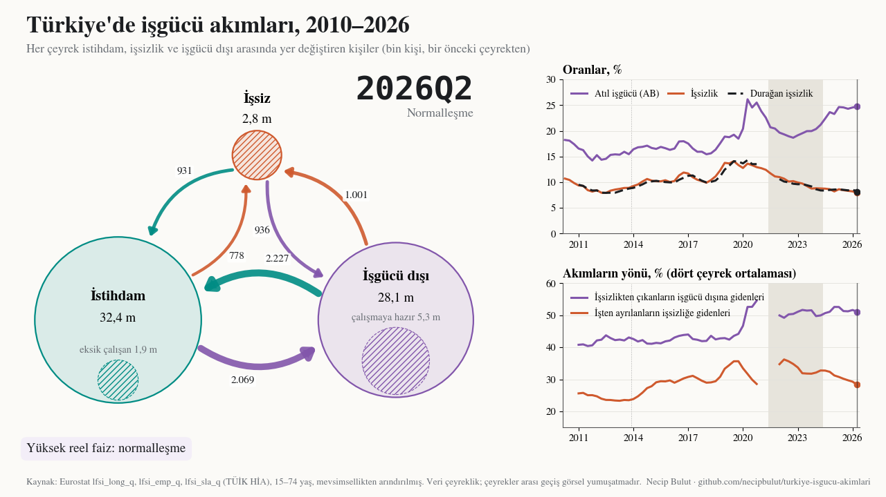
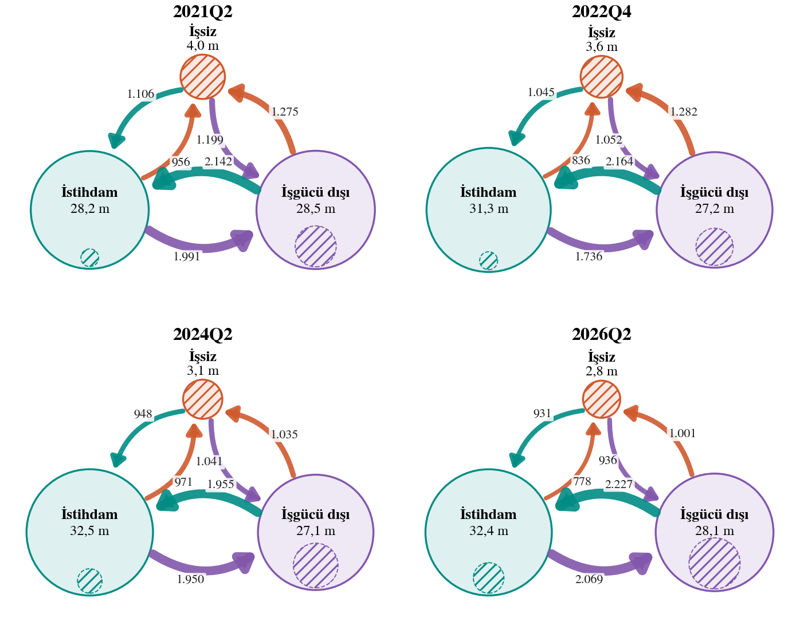
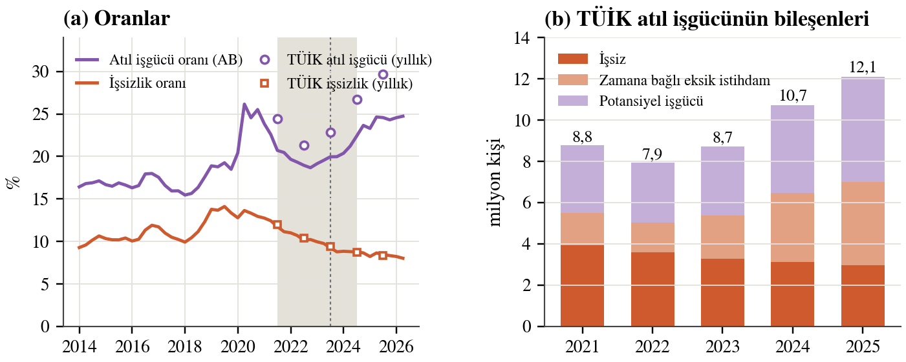
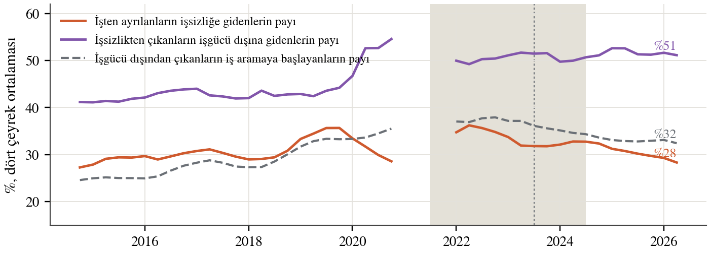
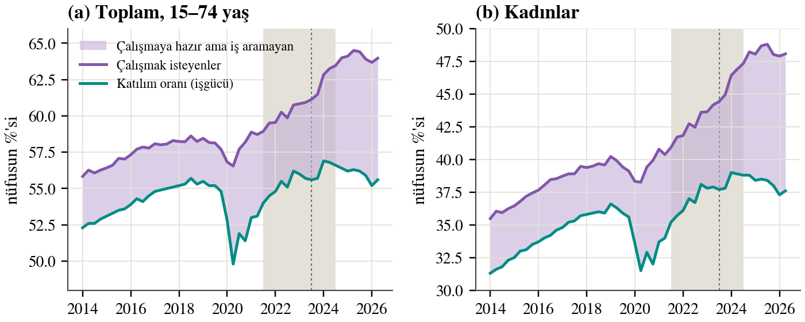
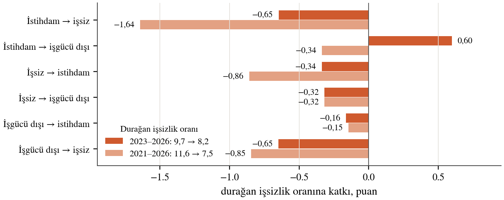

# Düşen İşsizlik, Artan Atıl İşgücü: Türkiye'de İşgücü Akımları, 2021–2026

Türkiye'de işsizlik oranı 2021'den beri düşüyor; atıl işgücü oranı ise 2023'ten beri yükseliyor. İki oran
arasındaki fark 2022'de 10,9 puandı, 2025'te 21,4 puana çıktı. Bu çalışma notu ayrışmanın nereden geldiğini
işgücü özdeşlikleri, anketin panel kısmından hesaplanan işgücü akımları ve çalışma saatleri üzerinden inceliyor.

**[Raporu oku (PDF)](rapor/isgucu_akimlari_raporu.pdf)** ·
**[Vitrin sayfası](https://necipbulut.github.io/turkiye-isgucu-akimlari/)** ·
**[Etkileşimli akım haritası](https://necipbulut.github.io/turkiye-isgucu-akimlari/akim-haritasi.html)** ·
**[Akım videosu, 2010–2026](https://necipbulut.github.io/turkiye-isgucu-akimlari/#video)**

Necip Bulut · "Three Essays on Monetary Economics" doktora tezinin üçüncü makalesi için arka plan çalışması · Ekim 2026

---

## Ana bulgular

1. 2022'de işsizlik %12,0'dan %10,4'e, atıl işgücü %24,4'ten %21,3'e indi. Fark 2023 başında açılmaya başladı;
   AB tanımlı serideki genişlemenin yarısı negatif reel faiz döneminin son altı çeyreğinde, yarısı yüksek reel
   faizli normalleşmede oldu.
2. Negatif reel faizli indirim evresinde (2021Q3–2023Q2) işsizliği iş yaratma düşürdü: istihdam oranı 3,7 puan
   arttı. Normalleşmede (2024Q3–2026Q1) işsizlik, katılım düştüğü için geriledi.
3. İşten ayrılanların işsizliğe gidenlerin payı %35'ten %28'e indi; ayrılanların yaklaşık dörtte üçü artık
   işgücü dışına gidiyor.
4. Çalışmak isteyenlerin oranı 2024'ten sonra yüksek kaldı, katılım düştü. Aradaki açık, iş aramayıp çalışmaya
   hazır bekleyen kişiler: 2022 sonundan 2026 başına 2,45 milyon kişi arttı.
5. Durağan işsizlik oranı 2024 ortasından beri %8,2–8,6 aralığında yatay; akımlar artık işsizliği aşağı itmiyor.
6. Kişi başı haftalık çalışma 43,3 saatten 41,7 saate indi; kısmi süreli çalışanların payı %10,9'dan %14,1'e çıktı.

## Akımlar 2010'dan 2026'ya (video)

*38 saniyelik video: üç durum arasındaki akımlar 65 çeyrek boyunca; sağda işsizlik, atıl işgücü ve durağan işsizlik ile
akımların yönü zamanla çiziliyor. Veri çeyreklik; çeyrekler arası geçiş görsel yumuşatmadır. Dosya:
[`video/isgucu_akimlari_2010_2026.mp4`](video/isgucu_akimlari_2010_2026.mp4).*

## Grafiklerle

*Dört çeyrekte istihdam, işsiz ve işgücü dışı arasındaki akımlar (bin kişi, bir önceki çeyrekten). Daire alanı
stok, ok kalınlığı akım; taralı kısımlar atıl işgücüne giren gruplar.*

*İşsizlik oranı ve atıl işgücü oranı (sol); TÜİK atıl işgücünün bileşenleri (sağ). Gri bant: negatif reel faiz
dönemi, 2021Q3–2024Q2.*

*İşten ayrılanların işsizliğe, işsizlikten çıkanların işgücü dışına, işgücü dışından çıkanların iş aramaya
gidenlerinin payı (dört çeyrek ortalaması).*

*Katılım oranı ile çalışmak isteyenlerin oranı arasındaki açık: çalışmaya hazır ama iş aramayan kişiler.*

*Durağan işsizlik oranındaki değişimin akımlara göre kaynakları.*

Bütün grafikler (12 adet, PNG ve SVG) [`figurler/`](figurler/) klasöründe.

## Veri

- **TÜİK Hanehalkı İşgücü Anketi.** Temel göstergeler (15+ yaş, aylık) TCMB EVDS'ten (TP.TIG01–08, TP.YISGUCU2.G1–G8).
- **Eurostat (TÜİK'in gönderdiği seriler, 15–74 yaş).** Atıl işgücü bileşenleri (lfsi_sla_q), işgücü akımları
  (lfsi_long_q), katılım (lfsi_emp_q), çalışma saatleri (lfsq_ewhais), sektör (lfsq_egan2), statü ve kısmi süreli
  çalışma (lfsq_eftpt).
- **TÜİK İşgücü İstatistikleri yıllık bültenleri, 2021–2025.** Atıl işgücü oranları (LU2, LU3, LU4).
- Veriler 6 Ekim 2026'da çekildi. 2021Q1'de anket yöntemi değişti; akım serisinde o çeyrek yok ve bütün
  karşılaştırmalar 2021Q2'den başlıyor.

## Klasörler

| Klasör | İçerik |
|---|---|
| `rapor/` | PDF rapor ve HTML kaynağı |
| `figurler/` | Rapordaki 12 grafik (PNG, SVG) |
| `veri/` | İşlenmiş tablolar (CSV) ve akım haritasının verisi (`akim_data.json`) |
| `kod/` | Veri çekme, analiz, grafik ve sayfa üretim betikleri (Python) |
| `video/` | Akım videosu (MP4, 2010–2026) ve kapak görseli |
| `docs/` | GitHub Pages: vitrin sayfası, akım videosu ve etkileşimli akım haritası |

## Yeniden üretim

Betikler Python 3 (pandas, numpy, matplotlib, evds) ile çalışır. Sıra: `e01_fetch.py` (EVDS ve Eurostat'tan veri;
EVDS için kendi API anahtarınızı `.env` dosyasında `EVDS_KEY=` olarak tanımlayın, depoda anahtar yok) →
`e02_analysis.py` (tablolar; GSYH için EVDS'ten zincirlenmiş hacim serisi gerekir) → `e05_flows_data.py`
(akım haritası verisi) → `e06_report_figs.py` (rapor grafikleri) → `e08_video.py` (akım videosu; ffmpeg gerekir). Betikler tez klasör yapısında yazıldı; dosya
yolları gerekirse uyarlanmalı. İşlenmiş çıktılar `veri/` klasöründe olduğu için grafikler `e06_report_figs.py`
ile doğrudan yeniden üretilebilir.

## Atıf

Bulut, N. (2026). *Düşen İşsizlik, Artan Atıl İşgücü: Türkiye'de İşgücü Akımları, 2021–2026.* Çalışma notu.
https://github.com/necipbulut/turkiye-isgucu-akimlari

Bu bir çalışma notudur; mekanizmaların nedensel etkisi test edilmedi. Yorum ve önerilere açığım.
